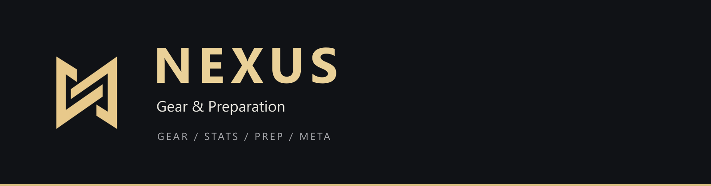
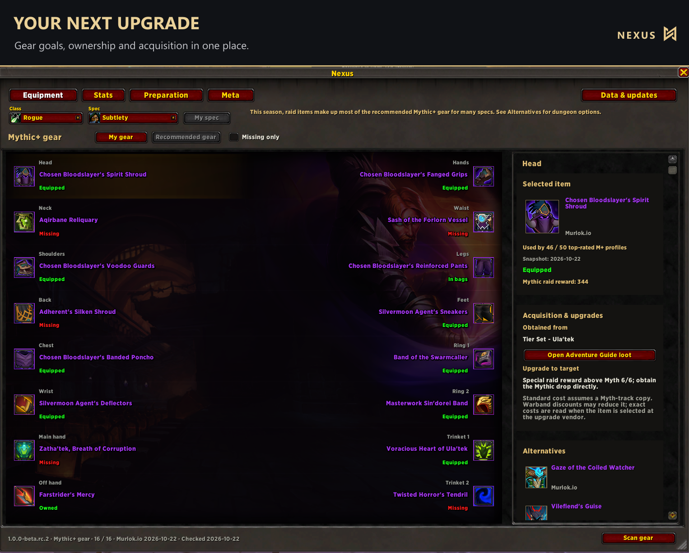
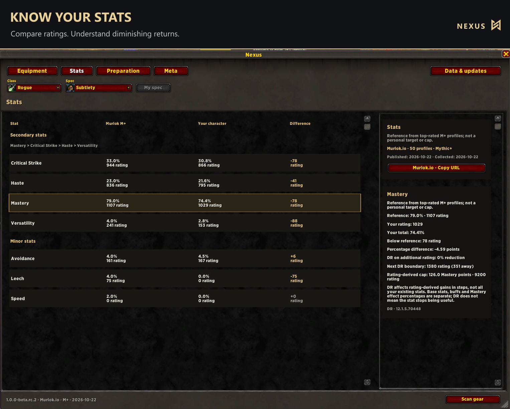
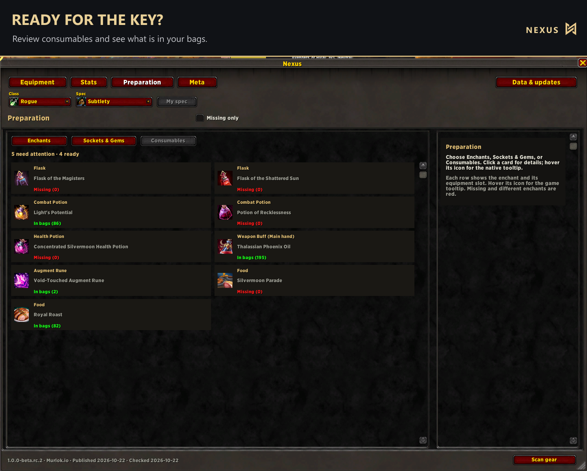
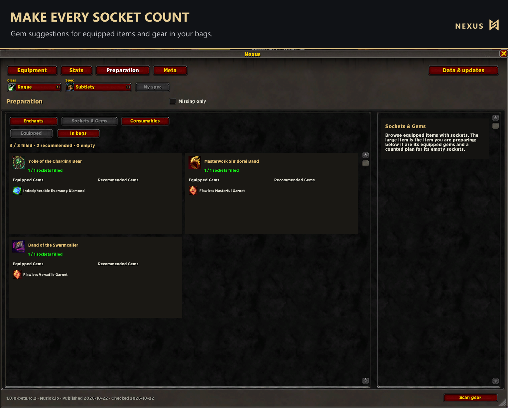
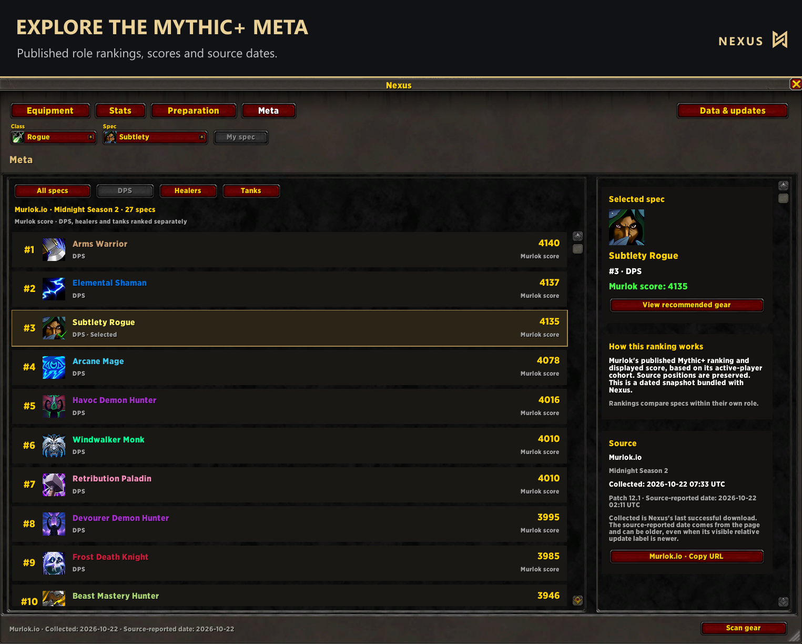

# Nexus: Gear & Preparation

[Install on CurseForge](https://www.curseforge.com/wow/addons/nexus-gear-preparation) · [Download on GitHub](https://github.com/Therealwixin/Nexus/releases) · [Report an issue](https://github.com/Therealwixin/Nexus/issues)

Nexus brings Mythic+ gear goals, character stats, preparation and role rankings into one World of Warcraft Retail window. Browse all 40 specializations, see what your character already owns and plan what to work on next.

## Equipment: find your next upgrade

- Browse current-season Mythic+ recommendations based on Murlok.io top-player aggregates.
- See whether an item is equipped, in your bags or missing, with a missing-only filter.
- Compare up to four verified alternatives per slot, including dungeon options where available.
- Check acquisition details, upgrade information and Adventure Guide loot links where supported.
- Get an entry popup in dungeons and raids when the native loot pool contains a missing recommended item or relevant alternative for your active spec. Picks and alternatives are labelled separately; owned items and clearly outclassed alternatives are filtered.
- Use native item tooltips and specialization talent artwork in a familiar Warcraft interface.

Mythic+ describes the activity the gear is recommended for, not where every item drops. This season, raid items make up much of the recommended gear for many specs. Nexus includes raid drops and crafted items when relevant; dungeon alternatives are shown where verified. There is currently no separate raid recommendation mode or raid Meta.

## Stats: understand your character

Compare your character's secondary and minor stats with references from top-rated Mythic+ profiles. View rating and percentage differences, and inspect diminishing-return brackets, the next rating boundary and rating-derived limits where supported by the client.

These are observed reference values, not mandatory targets or a personal simulation. A displayed reference or DR boundary does not mean a stat stops being useful.

## Preparation: get ready for the key

Review recommended enchants, sockets, gem suggestions and consumables. Check socketed items equipped on your character or in your bags, see filled and empty sockets, and review consumable bag counts. Missing-only filters help you focus on what needs attention.

Your actual equipment and bag checks follow the current character. You can browse other specializations without switching your in-game spec.

## Meta: explore your role

Browse Murlok.io's published Mythic+ rankings for DPS, healers and tanks. Scores and positions are compared within each role, with source details and dates available in the addon. These are published M+ rankings, not DPS/HPS throughput measurements or a personal performance prediction.

## Sources and updates

Murlok.io supplies Mythic+ gear usage, stat references and role rankings. Wowhead and Icy Veins provide authored recommendations and verified alternative/acquisition evidence where available. Source labels, sample sizes where available and dates help you understand each recommendation.

Data is checked daily by an external update workflow. Successful validated updates are distributed as new addon versions. If collection or validation fails, the last verified data stays available with its original dates. The addon makes no internet requests inside WoW. Install updates through CurseForge or GitHub; **Scan gear** only rescans your character's equipment and bags.

## Getting started

Install Nexus for World of Warcraft Retail and open it with `/nexus` or its minimap button. Choose a class and specialization to browse; use **My spec** to return to your active specialization.

- `/nexus` — open or close Nexus.
- `/nexus scan` — rescan equipment and bags.
- `/nexus sources` — open Data & updates.
- `/nexus debug` — show copyable diagnostics.
- `/nexus resetui` — reset window placement and size.

English, Slovak and Czech interface text is included. Recommendations help you plan; gear popularity is not a replacement for simulating your own character.

## Screenshots

Actual in-game screenshots with added promotional title strips. The interface beneath each strip is unmodified.







## Manual installation

Download the installable Nexus ZIP from Releases, close WoW and extract the `Nexus` folder into `_retail_/Interface/AddOns/`. The final path must be `_retail_/Interface/AddOns/Nexus/Nexus.toc`. Preserve SavedVariables. Do not use GitHub's automatic source-code ZIP as the addon package.

## Development and data maintenance

Python 3.12 and `lupa==2.8` are used outside the game:

```text
python tools/refresh_gear.py --validate-only
python tools/test_lean.py
python tools/test_stats.py
python tools/test_maintenance.py
python tools/test_meta.py
python tools/test_guides.py
python tools/test_alternatives.py
python tools/package.py --output dist
```

See [data sources](DATA-SOURCES.md), [update setup](SETUP.md) and [Slovak update instructions](AKTUALIZACIE_SK.md). The [CurseForge description](CURSEFORGE.md) and [marketing asset manifest](assets/marketing/README.md) are maintained in this repository. The external collector uses aggregate pages; individual player-profile pages are not collected. No API keys, browser dependencies or marketing screenshots are bundled in the addon.

License: the owner's existing All Rights Reserved terms in `Nexus/LICENSE.txt`.
